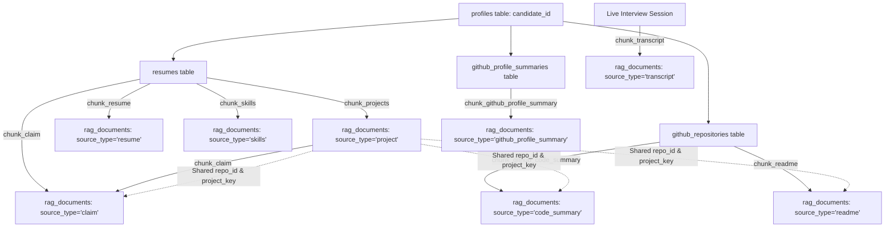

# Comprehensive RAG Chunking, Linking & Retrieval Architecture Guide

This document is the authoritative specification of the RAG ingestion, chunking, graph linking, and retrieval architecture in AceView. It is designed to provide full, unambiguous context to an AI or engineer building or optimizing the **fetching (retrieval) engine** for AI-driven technical interviews.

---

## 1. System Overview & Architecture

AceView uses a **two-tier architecture**:
1. **Relational Database (`PostgreSQL`)**: Canonical source of truth (`profiles`, `resumes`, `github_repositories`, `github_profile_summaries`).
2. **Vector Database (`pgvector` via `rag_documents` table)**: Dense vector embeddings (384-dim) + rich JSONB metadata representing atomic, retrievable units from the resume, GitHub code, and live interview conversation turns.



---

## 2. Database Schema (`rag_documents`)

All chunks are persisted in PostgreSQL using the `rag_documents` table:

```sql
CREATE TABLE rag_documents (
    id UUID PRIMARY KEY DEFAULT gen_random_uuid(),
    user_id UUID NOT NULL REFERENCES profiles(id) ON DELETE CASCADE,
    source_type TEXT NOT NULL,          -- 'skills', 'project', 'resume', 'code_summary', 'readme', 'github_profile_summary', 'claim', 'transcript'
    chunk_id TEXT NOT NULL,             -- Unique deterministic string identifier
    content TEXT NOT NULL,              -- Natural language text embedded into vector
    metadata_ JSONB DEFAULT '{}'::jsonb,-- Rich metadata (tech tags, scores, keys)
    embedding VECTOR(384),              -- 384-dimensional dense vector (BAAI/bge-small-en-v1.5)
    source_ref TEXT,                    -- Section or origin indicator (e.g., 'experience', 'project:AceView')
    repo_id UUID REFERENCES github_repositories(id) ON DELETE SET NULL, -- FK to repository
    token_count INTEGER,                -- Model token count of content
    created_at TIMESTAMPTZ NOT NULL DEFAULT now(),
    deleted_at TIMESTAMPTZ,             -- Soft-deletion / tombstoning timestamp
    CONSTRAINT unique_profile_chunk UNIQUE (user_id, chunk_id)
);

-- Essential Indexes
CREATE INDEX rag_documents_embedding_idx ON rag_documents USING hnsw (embedding vector_cosine_ops);
CREATE INDEX idx_rag_documents_profile_id ON rag_documents(user_id);
CREATE INDEX idx_rag_documents_user_source ON rag_documents(user_id, source_type);
CREATE INDEX idx_rag_documents_repo_id ON rag_documents(repo_id) WHERE repo_id IS NOT NULL;
CREATE INDEX idx_rag_documents_deleted_at ON rag_documents(deleted_at);
```

### Key Schema Characteristics for Retrieval:
- **`user_id` Scoping:** All retrieval queries MUST filter by `user_id == candidate_id`.
- **Soft Deletions / Tombstoning:** When a candidate re-uploads a resume or re-scrapes GitHub, obsolete chunks have `deleted_at = NOW()`. All retrieval queries MUST filter `deleted_at IS NULL`.
- **Vector Operator:** Cosine similarity distance operator in pgvector is `<=>`. Cosine similarity is computed as:
  $$\text{similarity} = 1 - (\text{embedding} \iff \text{query\_vector})$$
- **Similarity Floor:** Default cosine similarity threshold is **`0.35`**. Anything below 0.35 is discarded as irrelevant noise.

---

## 3. The 8 Chunk Types (Exhaustive Breakdown)

Each chunk represents a distinct source of intelligence for the interviewer.

### 1. `source_type = "skills"`
- **Generated by:** `chunk_skills()` in `server/rag/chunking.py`.
- **Logic:** Skills from `resumes.skills` are clustered strictly by semantic domain using `SKILL_TAXONOMY` (`language`, `backend`, `frontend`, `infra`, `data`, `tools`). No chunk mixes categories.
- **Batch Size:** Up to 15 skills per chunk.
- **Chunk ID Scheme:** `{candidate_id}-skills-{category}` (or `-1`, `-2` if >15 skills in a category).
- **Example Chunk:**
```json
{
  "chunk_id": "00000000-0000-0000-0000-000000000001-skills-backend",
  "source_type": "skills",
  "section": "skills:backend",
  "repo_id": null,
  "text": "Candidate Technical Skills (Backend): FastAPI, PostgreSQL, Redis, Celery, Docker, RabbitMQ",
  "metadata": {
    "section": "skills:backend",
    "skill_category": "backend",
    "skills": ["FastAPI", "PostgreSQL", "Redis", "Celery", "Docker", "RabbitMQ"],
    "category_skills_count": 6,
    "all_skills_count": 28,
    "detected_tech": ["fastapi", "postgresql", "redis", "celery", "docker", "rabbitmq"]
  }
}
```

---

### 2. `source_type = "project"`
- **Generated by:** `chunk_projects()` in `server/rag/chunking.py`.
- **Logic:** Built from structured resume projects (`resumes.projects`) and project links. Formats title, description, skills/technologies, URL, and key highlights together.
- **Repository Matching:** Matches against `github_repositories` using direct URL, repo slug, or normalized title key via `_find_matching_repo`.
- **Chunk ID Scheme:** `{candidate_id}-project-{project_key}`.
- **Example Chunk:**
```json
{
  "chunk_id": "00000000-0000-0000-0000-000000000001-project-aceview-cloud",
  "source_type": "project",
  "section": "project:AceView Cloud",
  "repo_id": "c1b3f9b2-3211-4712-b918-6c8411bcf234",
  "text": "Project: AceView Cloud\nDescription: Real-time AI technical interview platform with sub-second audio response.\nTechnologies: React, FastAPI, PostgreSQL, Redis, WebRTC\nLink: https://github.com/candidate/aceview-cloud",
  "metadata": {
    "section": "project:AceView Cloud",
    "project_name": "AceView Cloud",
    "project_key": "aceview-cloud",
    "description": "Real-time AI technical interview platform with sub-second audio response.",
    "technologies": ["React", "FastAPI", "PostgreSQL", "Redis", "WebRTC"],
    "url": "https://github.com/candidate/aceview-cloud",
    "repo_id": "c1b3f9b2-3211-4712-b918-6c8411bcf234",
    "github_repo_id": "c1b3f9b2-3211-4712-b918-6c8411bcf234",
    "github_repo_name": "aceview-cloud",
    "github_url": "https://github.com/candidate/aceview-cloud",
    "detected_tech": ["react", "fastapi", "postgresql", "redis", "webrtc"]
  }
}
```

---

### 3. `source_type = "resume"`
- **Generated by:** `chunk_resume()` and `_split_into_logical_entries()`.
- **Logic:** Slices resume sections (Experience, Education, Achievements, Certifications, Summary) along **natural logical entry boundaries**:
  - **Experience:** 1 discrete chunk per job (splits on date ranges or role/company headers). Bullet points are kept attached.
  - **Education:** 1 discrete chunk per degree (splits on degree keywords, universities, and graduation dates).
  - **Achievements / Awards:** 1 chunk per bullet point or dated accomplishment.
  - **Summary / Prose:** Kept whole unless >200 tokens, where it groups 2–3 sentences via spaCy linguistic segmentation.
- **Sizing Rule:** Entries $\le 250$ tokens remain 100% whole. Only entries exceeding 250 tokens get split into sentence-snapped token windows (max 250 tokens, 40 token overlap). Hard limit ceiling: 480 tokens.
- **Chunk ID Scheme:** `{candidate_id}-resume-{section_slug}-{entry_idx}-{window_idx}`.
- **Example Chunk:**
```json
{
  "chunk_id": "00000000-0000-0000-0000-000000000001-resume-experience-1-1",
  "source_type": "resume",
  "section": "experience",
  "repo_id": null,
  "text": "Senior Backend Engineer | Stripe (Jan 2022 - Present)\n- Architected high-throughput ledger processing service handling 10k transactions/sec.\n- Replaced legacy polling system with Redis Pub/Sub, decreasing webhook latency by 65%.\n- Mentored 4 junior engineers on distributed tracing and OpenTelemetry instrumentation.",
  "metadata": {
    "section": "experience",
    "entry_index": 1,
    "years_of_experience": 4.5,
    "detected_tech": ["redis", "opentelemetry"]
  }
}
```

---

### 4. `source_type = "code_summary"` (The Tri-Chunk Split)
- **Generated by:** `chunk_github_code_summary()`.
- **Logic:** Instead of blending architecture, test coverage, and commit habits into one noisy paragraph, **every GitHub repository gets exactly 3 focused sub-chunks**:
  1. `summary_kind = "architecture"`: Languages, framework detection, architectural complexity score, lines of code breakdown.
  2. `summary_kind = "testing"`: Test coverage score, code complexity, documentation score.
  3. `summary_kind = "commits"`: Commit frequency score, total commits analyzed, commit streak days, active days ratio.
- **Chunk ID Scheme:** `{candidate_id}-code-{repo_name}-{summary_kind}`.
- **Why this matters for retrieval:** If an interviewer asks *"How does the candidate approach testing?"*, the system retrieves the pure `testing` chunk without diluting similarity with commit habit or language sentences.
- **Example Chunks:**
```json
// Architecture Chunk
{
  "chunk_id": "00000000-0000-0000-0000-000000000001-code-aceview-cloud-architecture",
  "source_type": "code_summary",
  "section": "aceview-cloud:architecture",
  "repo_id": "c1b3f9b2-3211-4712-b918-6c8411bcf234",
  "text": "Repository Architecture & Code Structure: aceview-cloud\nPrimary languages: Python (65%), TypeScript (35%).\nArchitecture score: 85.0/100. Overall code health: 88.0/100.\nRepository description: Real-time AI technical interview platform.",
  "metadata": {
    "summary_kind": "architecture",
    "repo_name": "aceview-cloud",
    "project_key": "aceview-cloud",
    "architecture_score": 85.0,
    "overall_code_score": 88.0,
    "languages": {"Python": 65000, "TypeScript": 35000},
    "detected_tech": ["python", "typescript"]
  }
}

// Testing Chunk
{
  "chunk_id": "00000000-0000-0000-0000-000000000001-code-aceview-cloud-testing",
  "source_type": "code_summary",
  "section": "aceview-cloud:testing",
  "repo_id": "c1b3f9b2-3211-4712-b918-6c8411bcf234",
  "text": "Repository Testing & Quality: aceview-cloud\nTesting score: 42.0/100. Code complexity score: 78.0/100. Documentation score: 80.0/100.",
  "metadata": {
    "summary_kind": "testing",
    "repo_name": "aceview-cloud",
    "project_key": "aceview-cloud",
    "testing_score": 42.0,
    "complexity_score": 78.0,
    "documentation_score": 80.0,
    "detected_tech": []
  }
}
```

---

### 5. `source_type = "readme"`
- **Generated by:** `chunk_readme()` and `_clean_readme_markdown()`.
- **Logic:** Raw READMEs are sanitized before chunking:
  - Strips badges, shields, CI build icons (`shields.io`, `codecov`).
  - Strips Table of Contents (TOC) blocks and anchor jump links.
  - Strips license, legal disclaimers, and copyright lines.
  - Splits along markdown headers (`#`, `##`, `###`) into discrete sections (Architecture, Setup, Database Design). If no headings exist, falls back to sentence-snapped token windows.
- **Chunk ID Scheme:** `{candidate_id}-readme-{repo_name}-{section_slug}-{window_idx}`.
- **Example Chunk:**
```json
{
  "chunk_id": "00000000-0000-0000-0000-000000000001-readme-aceview-cloud-architecture-1",
  "source_type": "readme",
  "section": "aceview-cloud:architecture",
  "repo_id": "c1b3f9b2-3211-4712-b918-6c8411bcf234",
  "text": "Repository: aceview-cloud\nSection: Architecture\nAceView uses a dual-worker architecture. Ingestion is handled asynchronously by Celery workers writing to Redis, while the FastAPI web server serves incoming WebRTC connections.",
  "metadata": {
    "repo_name": "aceview-cloud",
    "project_key": "aceview-cloud",
    "section_title": "Architecture",
    "repo_id": "c1b3f9b2-3211-4712-b918-6c8411bcf234",
    "detected_tech": ["celery", "redis", "fastapi", "webrtc"]
  }
}
```

---

### 6. `source_type = "github_profile_summary"`
- **Generated by:** `chunk_github_profile_summary()`.
- **Logic:** High-level summary of candidate developer habits across all repositories.
- **Content:** Total annual contributions, longest commit streak, active days ratio, PR review participation, community impact, primary languages.
- **Chunk ID Scheme:** `{candidate_id}-github_profile_summary`.

---

### 7. `source_type = "claim"` (Verifiable Assertions)
- **Generated by:** `chunk_claim()` in `server/rag/chunking.py`.
- **Logic:** Extracts discrete, checkable factual claims made in project descriptions and resume bullets:
  - Scans for numbers, percentages, multipliers, or strong architectural verbs.
  - Categorizes claims into `metric`, `architecture`, `leadership`, or `other` using `_classify_claim()`.
  - Attaches `project_key`, `repo_id`, and `verified: False`.
- **Chunk ID Scheme:** `{candidate_id}-claim-{hash}`.
- **Example Chunk:**
```json
{
  "chunk_id": "00000000-0000-0000-0000-000000000001-claim-a9f182c03e41",
  "source_type": "claim",
  "section": "claim:metric",
  "repo_id": "c1b3f9b2-3211-4712-b918-6c8411bcf234",
  "text": "Replaced legacy polling system with Redis Pub/Sub, decreasing webhook latency by 65%.",
  "metadata": {
    "claim_type": "metric",
    "project_key": "aceview-cloud",
    "verified": false,
    "detected_tech": ["redis"],
    "repo_id": "c1b3f9b2-3211-4712-b918-6c8411bcf234"
  }
}
```

---

### 8. `source_type = "transcript"` (Live Interview Turns)
- **Generated by:** `chunk_transcript()` during live interview execution.
- **Logic:** Every time a candidate answers a question, that (Question, Answer) turn is embedded and stored.
- **Content:** The exact question, the candidate's transcript response, turn index, topic, and evaluation score.
- **Chunk ID Scheme:** `{candidate_id}-turn-{turn_number}`.
- **Example Chunk:**
```json
{
  "chunk_id": "00000000-0000-0000-0000-000000000001-turn-3",
  "source_type": "transcript",
  "section": "turn-3",
  "repo_id": null,
  "text": "Question: Why did you choose Redis Pub/Sub instead of Kafka for your webhook worker?\nAnswer: Because our workload was sub-second and ephemeral; we didn't need durable log replay on disk, so Kafka's operational overhead wasn't justified.",
  "metadata": {
    "turn_number": 3,
    "question_topic": "message_queues",
    "evaluation_score": 9.0,
    "detected_tech": ["redis", "kafka"]
  }
}
```

---

## 4. Cross-Source Linking Mechanics

The RAG engine connects chunks across tables and sources via 4 deterministic links:

### 1. `repo_id` (Postgres Foreign Key)
- Directly links `project`, `code_summary`, `readme`, and `claim` chunks to the `github_repositories` row.
- **How it's resolved:** In `_find_matching_repo`, the system checks:
  1. Exact GitHub URL match (`https://github.com/org/repo`)
  2. GitHub URL slug match (`repo` from URL)
  3. Pre-resolved `project_name`
  4. Normalized title slug (`normalize_project_key(title) == normalize_project_key(repo_name)`)

### 2. `project_key` (Normalized String Slug)
- Generated by `normalize_project_key(name)`:
  - Lowercases, replaces spaces and underscores with hyphens, strips non-alphanumeric characters.
  - Example: `"AceView Cloud (v2.0)"` $\rightarrow$ `"aceview-cloud-v20"`.
- Shared across:
  - `project` chunk (`metadata["project_key"]`)
  - `code_summary` chunks (`metadata["project_key"]`)
  - `readme` chunks (`metadata["project_key"]`)
  - `claim` chunks (`metadata["project_key"]`)

### 3. `detected_tech` (JSONB Technology Tag Index)
- Extracted automatically on EVERY chunk using spaCy's `EntityRuler` (`extract_tech_entities()`).
- Normalizes tech variants (e.g., `"postgres"`, `"postgresql"` $\rightarrow$ `["postgresql"]`).
- Stored as a lowercased JSONB string array in `metadata_["detected_tech"]`.
- Supports direct PostgreSQL JSONB operators:
  ```sql
  -- Chunks containing 'redis'
  WHERE metadata_->'detected_tech' ? 'redis'
  
  -- Chunks containing BOTH 'python' and 'fastapi'
  WHERE metadata_->'detected_tech' ?& ARRAY['python', 'fastapi']
  
  -- Chunks containing EITHER 'kafka' OR 'rabbitmq'
  WHERE metadata_->'detected_tech' ?| ARRAY['kafka', 'rabbitmq']
  ```

---

## 5. Fetching (Retrieval) Engine Patterns

The retrieval engine should not just do blind vector search. It must combine **structured SQL filtering** with **dense semantic similarity (HNSW cosine search)**.

Here are the 6 essential retrieval patterns required for the interview agent:

### Pattern 1: Topic Semantic Retrieval with Similarity Floor
Used to find context for a specific technical question topic.
```python
def retrieve_semantic_context(
    session: Session,
    query: str,
    candidate_id: str,
    k: int = 4,
    source_type_filter: list[str] | None = None,
    min_similarity: float = 0.35,
) -> list[RetrievedChunk]:
    """Embeds query and executes cosine similarity search on pgvector."""
    query_vector = embed_texts([query])[0]
    c_uuid = uuid.UUID(str(candidate_id))

    stmt = select(
        RagDocument,
        (1 - RagDocument.embedding.cosine_distance(query_vector)).label("similarity")
    ).where(
        RagDocument.user_id == c_uuid,
        RagDocument.deleted_at.is_(None),
    )

    if source_type_filter:
        stmt = stmt.where(RagDocument.source_type.in_(source_type_filter))

    # Apply similarity floor and order by similarity DESC
    stmt = (
        stmt.having((1 - RagDocument.embedding.cosine_distance(query_vector)) >= min_similarity)
        .order_by(RagDocument.embedding.cosine_distance(query_vector).asc())
        .limit(k)
    )

    results = session.execute(stmt).all()
    return [
        RetrievedChunk(
            chunk_id=row.RagDocument.chunk_id,
            source_type=row.RagDocument.source_type,
            section=row.RagDocument.source_ref,
            text=row.RagDocument.content,
            similarity=float(row.similarity),
            repo_id=str(row.RagDocument.repo_id) if row.RagDocument.repo_id else None,
            metadata=row.RagDocument.metadata_ or {},
        )
        for row in results
    ]
```

---

### Pattern 2: Project Deep-Dive (Resume Claim vs. Code Reality)
When the interviewer wants to interrogate a specific project, fetch the resume's claims and the GitHub code reality in one unified call:
```python
def get_project_deep_dive(
    session: Session,
    candidate_id: str,
    project_key: str,
) -> dict[str, Any]:
    """
    Fetches:
    1. Project description & tech stack (source_type = 'project')
    2. Verifiable claims made about this project (source_type = 'claim')
    3. Architecture code summary (source_type = 'code_summary', summary_kind = 'architecture')
    4. Testing & code quality scores (source_type = 'code_summary', summary_kind = 'testing')
    5. README architecture documentation (source_type = 'readme')
    """
    c_uuid = uuid.UUID(str(candidate_id))
    chunks = session.scalars(
        select(RagDocument).where(
            RagDocument.user_id == c_uuid,
            RagDocument.deleted_at.is_(None),
            RagDocument.metadata_["project_key"].astext == project_key,
        )
    ).all()

    deep_dive = {
        "project": None,
        "claims": [],
        "code_architecture": None,
        "code_testing": None,
        "code_commits": None,
        "readme_sections": [],
    }

    for c in chunks:
        if c.source_type == "project":
            deep_dive["project"] = c.content
        elif c.source_type == "claim":
            deep_dive["claims"].append({"text": c.content, "type": c.metadata_.get("claim_type")})
        elif c.source_type == "code_summary":
            kind = c.metadata_.get("summary_kind")
            if kind == "architecture":
                deep_dive["code_architecture"] = c.content
            elif kind == "testing":
                deep_dive["code_testing"] = c.content
            elif kind == "commits":
                deep_dive["code_commits"] = c.content
        elif c.source_type == "readme":
            deep_dive["readme_sections"].append(c.content)

    return deep_dive
```
**Interviewer Prompt Generation Opportunity:**
If the candidate claimed: *"Achieved 95% test coverage in AceView Cloud"* (`claim`), but the code summary shows: `Testing score: 42.0/100` (`code_summary:testing`), the interviewer can specifically ask:
> *"In your resume you noted achieving high test coverage on AceView Cloud, but our repository analysis identified limited automated tests. How did you structure testing in that system?"*

---

### Pattern 3: Fact-Checking Unverified Claims
Retrieve high-impact, quantifiable claims for targeted interview questions:
```python
def get_unverified_claims(
    session: Session,
    candidate_id: str,
    claim_type: str | None = "metric", # 'metric', 'architecture', 'leadership'
    limit: int = 5,
) -> list[RetrievedChunk]:
    """Retrieves specific verifiable claims made in resume/projects."""
    c_uuid = uuid.UUID(str(candidate_id))
    stmt = select(RagDocument).where(
        RagDocument.user_id == c_uuid,
        RagDocument.source_type == "claim",
        RagDocument.deleted_at.is_(None),
    )
    if claim_type:
        stmt = stmt.where(RagDocument.metadata_["claim_type"].astext == claim_type)

    stmt = stmt.limit(limit)
    rows = session.scalars(stmt).all()
    return [
        RetrievedChunk(
            chunk_id=r.chunk_id,
            source_type=r.source_type,
            section=r.source_ref,
            text=r.content,
            similarity=1.0,
            repo_id=str(r.repo_id) if r.repo_id else None,
            metadata=r.metadata_ or {},
        )
        for r in rows
    ]
```

---

### Pattern 4: Technology-Filtered Vector Search (Hybrid Retrieval)
Ensures semantic search is strictly confined to chunks that actually mention the target technology:
```python
def retrieve_by_tech(
    session: Session,
    query: str,
    candidate_id: str,
    technology: str, # e.g. 'redis'
    k: int = 3,
) -> list[RetrievedChunk]:
    """Combines JSONB exact tech containment (? operator) with dense vector similarity."""
    query_vector = embed_texts([query])[0]
    c_uuid = uuid.UUID(str(candidate_id))
    tech_clean = technology.str ip().lower()

    stmt = (
        select(
            RagDocument,
            (1 - RagDocument.embedding.cosine_distance(query_vector)).label("similarity")
        )
        .where(
            RagDocument.user_id == c_uuid,
            RagDocument.deleted_at.is_(None),
            RagDocument.metadata_["detected_tech"].op("?")(tech_clean),
        )
        .order_by(RagDocument.embedding.cosine_distance(query_vector).asc())
        .limit(k)
    )
    results = session.execute(stmt).all()
    return [
        RetrievedChunk(
            chunk_id=row.RagDocument.chunk_id,
            source_type=row.RagDocument.source_type,
            section=row.RagDocument.source_ref,
            text=row.RagDocument.content,
            similarity=float(row.similarity),
            repo_id=str(row.RagDocument.repo_id) if row.RagDocument.repo_id else None,
            metadata=row.RagDocument.metadata_ or {},
        )
        for row in results
    ]
```

---

### Pattern 5: Conversational Callbacks (Live Transcript Memory)
Enables the interviewer to formulate natural callbacks to earlier answers in the interview:
```python
def get_transcript_callbacks(
    session: Session,
    candidate_id: str,
    current_topic: str,
    current_turn: int,
    k: int = 2,
) -> list[RetrievedChunk]:
    """Finds prior answers from earlier turns that discussed the current topic."""
    query_vector = embed_texts([current_topic])[0]
    c_uuid = uuid.UUID(str(candidate_id))

    stmt = (
        select(
            RagDocument,
            (1 - RagDocument.embedding.cosine_distance(query_vector)).label("similarity")
        )
        .where(
            RagDocument.user_id == c_uuid,
            RagDocument.source_type == "transcript",
            RagDocument.deleted_at.is_(None),
            # Only search turns prior to the current turn
            cast(RagDocument.metadata_["turn_number"].astext, Integer) < current_turn,
        )
        .order_by(RagDocument.embedding.cosine_distance(query_vector).asc())
        .limit(k)
    )
    results = session.execute(stmt).all()
    return [
        RetrievedChunk(
            chunk_id=row.RagDocument.chunk_id,
            source_type=row.RagDocument.source_type,
            section=row.RagDocument.source_ref,
            text=row.RagDocument.content,
            similarity=float(row.similarity),
            repo_id=None,
            metadata=row.RagDocument.metadata_ or {},
        )
        for row in results
    ]
```
**Example Result:**
The agent retrieves turn 2 where the candidate said: *"We used Redis caching with a 60-second TTL."*
In turn 5 (Database design), the agent generates:
> *"Earlier in turn 2, you mentioned using a 60-second TTL on your Redis cache. How do you handle cache invalidation when a record is updated before that 60 seconds expires?"*

---

## 6. Recommended High-Level Retrieval Service Interface

Create `server/rag/retrieval_service.py` exposing this complete interface for the interview orchestration agent:

```python
from dataclasses import dataclass, field
from typing import Any
import uuid
from sqlalchemy.orm import Session

@dataclass
class RetrievedChunk:
    chunk_id: str
    source_type: str
    section: str
    text: str
    similarity: float
    repo_id: str | None = None
    metadata: dict[str, Any] = field(default_factory=dict)

class InterviewRetrievalService:
    def __init__(self, db: Session, candidate_id: str | uuid.UUID):
        self.db = db
        self.candidate_id = uuid.UUID(str(candidate_id))

    def get_candidate_skills_summary(self) -> dict[str, list[str]]:
        """Returns candidate skills grouped by category."""
        ...

    def get_project_deep_dive(self, project_key: str) -> dict[str, Any]:
        """Combines resume claims, code metrics, and README docs for a project."""
        ...

    def get_unverified_claims(self, claim_type: str = "metric", limit: int = 5) -> list[RetrievedChunk]:
        """Fetches checkable assertions for aggressive fact-probing."""
        ...

    def semantic_search(
        self,
        query: str,
        k: int = 4,
        source_types: list[str] | None = None,
        min_similarity: float = 0.35,
    ) -> list[RetrievedChunk]:
        """Standard pgvector dense vector similarity search with similarity floor."""
        ...

    def search_by_technology(self, query: str, tech: str, k: int = 3) -> list[RetrievedChunk]:
        """Hybrid search filtering on detected_tech JSONB tag + vector similarity."""
        ...

    def get_prior_answers_callback(self, topic: str, current_turn: int) -> list[RetrievedChunk]:
        """Retrieves candidate answers from earlier turns for conversational callbacks."""
        ...
```
